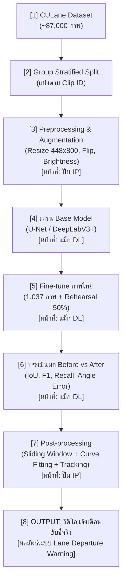

# Lane Detection and Tracking for Thai Roads 🚗💨

ระบบตรวจจับและติดตามเส้นช่องทางจราจรสำหรับสภาพถนนในประเทศไทย โดยประยุกต์ใช้เทคนิค **Computer Vision (Image Processing)** และ **Deep Learning (U-Net / DeepLabV3+)** ทำงานร่วมกันตามลำดับขั้นตอน (Pipeline) เพื่อสร้างระบบแจ้งเตือนการขับขี่ออกนอกเลน (Lane Departure Warning System: LDWS)

---

## 🔄 แผนผังกระบวนการทำงาน (End-to-End Pipeline)

กระบวนการพัฒนาและประมวลผลแบ่งออกเป็น 8 ขั้นตอนหลัก พร้อมการแบ่งหน้าที่รับผิดชอบชัดเจน:



---

## 👥 การแบ่งหน้าที่รับผิดชอบ (Team Roles)

| ส่วนงาน | ผู้รับผิดชอบหลัก | ขั้นตอนใน Pipeline | ขอบเขตหน้าที่ |
|---|:---:|:---:|---|
| **Image Processing (IP)** | **ปั๊ม** | ขั้นตอนที่ 3, 7, 8 | • Data Preprocessing & Augmentation<br>• Post-processing (Sliding Window, Curve Fitting, Tracking)<br>• สร้างวิดีโอผลลัพธ์และระบบแจ้งเตือนขับขี่จริง |
| **Deep Learning (DL)** | **แม็ก** | ขั้นตอนที่ 2, 4, 5, 6 | • Group Stratified Split ป้องกัน Data Leakage<br>• เทรน Base Model (CULane Dataset 61k ภาพ)<br>• Fine-tune บนถนนไทย (1,037 ภาพ) บังคับตีกรอบ 2 เลน พร้อม Rehearsal กันลืม<br>• Joint Training ผสม CULane + Thai เพื่อปลดล็อกโมเดลแชมป์ DeepLabV3+ |

---

## 📊 สรุปวิวัฒนาการและผลลัพธ์ของ 4 การทดลองหลัก (Evolution of 4 Experiments)

ประเมินบนชุดทดสอบทางการถนนไทย (**Thai Test Set 191 ภาพ** แบ่งตาม Group Stratified ป้องกัน Data Leakage):

### 1. ตารางเปรียบเทียบภาพรวม 4 ยุทธศาสตร์ (Master Strategy Comparison)

| อันดับ | ยุทธศาสตร์การทดลอง (Strategy) | ข้อมูลตั้งต้น $\to$ ข้อมูลที่ใช้เทรน | All IoU (%) | Precision (%) | Recall (%) | F1-Score (%) | มุมคลาดกลางคืน | สรุปผลลัพธ์เชิงประจักษ์ |
| :---: | :--- | :--- | :---: | :---: | :---: | :---: | :---: | :--- |
| 4 | **1. Zero-Shot** | CULane (จีน 61k) $\to$ ไม่เทรนเพิ่ม | 35.40% | 45.10% | 62.30% | 52.30% | 1.90° | **ติดกติกาจีน:** วาด 4 เลน โดนหัก False Positive หนัก |
| 3 | **2. Train Thai จากศูนย์** | ImageNet $\to$ ไทยล้วน (749 ภาพ) | 48.97% | 63.80% | 67.20% | 65.50% | 3.14° | **Data Bottleneck:** ข้อมูล 749 ภาพน้อยไป โมเดล Overfit |
| 2 | **3. Sequential Fine-Tune** | CULane $\to$ ไทยล้วน (749 ภาพ) | 50.63% | 66.34% | 68.14% | 67.23% | 26.56° *(ลืมกลางคืน)*<br>$\to$ 2.01° *(ใส่ Rehearsal)* | **Catastrophic Forgetting:** บีบ 2 เลนได้ แต่ต้องเติม Rehearsal กันลืมกลางคืน |
| 🏆 **1** | **4. Joint Training (ตัวจริง)** | CULane + Thai ผสมพร้อมกันในลูปเดียว | **55.12%** | **71.04%** | **68.74%** | **69.87%** | **1.77° (แม่นยำสุด)** | **ชนะทุกตัวชี้วัด:** ASPP ดึงฟีเจอร์หลายสเกล ไม่มีเส้นหลอกกวน IP |

---

### 2. ตารางเปรียบเทียบผล Fine-Tune ครบทั้ง 6 โมเดล (Sequential 6-Model Benchmark)

ไฟล์ผลลัพธ์: [`results/thai/finetune_sequential_6_models_comparison.csv`](results/thai/finetune_sequential_6_models_comparison.csv)

| อันดับ | โมเดล (Architecture + Backbone, Pretrained) | All IoU (%) | Precision (%) | Recall (%) | F1-Score (%) | Normal IoU (%) | Curve IoU (%) | Night IoU (%) |
| :---: | :--- | :---: | :---: | :---: | :---: | :---: | :---: | :---: |
| 1 | **DeepLabV3+ (ResNet-50, ImageNet)** | **50.63%** | 66.34% | 68.14% | **67.23%** | 56.29% | **36.71%** | **24.91%** |
| 2 | **DeepLabV3+ (ResNet-34, ImageNet)** | 50.54% | 65.44% | 68.95% | 67.15% | 57.31% | 35.57% | 20.43% |
| 3 | **U-Net (ResNet-34, ImageNet)** | 50.50% | 64.29% | 70.19% | 67.11% | **57.66%** | 28.87% | 24.23% |
| 4 | **U-Net (ResNet-50, ImageNet)** | 48.45% | 63.61% | 67.02% | 65.27% | 56.83% | 17.89% | 18.57% |
| 5 | **U-Net (ResNet-50, SSL MoCo v2)** | 47.83% | **66.82%** | **75.41%** | 64.71% | 54.98% | 25.21% | 21.38% |
| 6 | **DeepLabV3+ (ResNet-50, SSL MoCo v2)** | 46.67% | 65.33% | 62.03% | 63.64% | 54.81% | 22.68% | 16.30% |

> 📖 **อ่านรายงานวิจัยฉบับเต็มเจาะลึก 4 การทดลอง:** ดูได้ที่ [`EXPERIMENTS.md`](EXPERIMENTS.md)

---

## 📂 โครงสร้างโปรเจกต์ (Project Structure)

```text
Project-lane-detection-and-Tracking/
├── image_processing/             # 🛠️ ส่วนประมวลผลภาพ (Traditional CV & Post-processing) [ปั๊ม : IP]
│   ├── edge_detection.py         # การหาขอบภาพและกรองสี (HLS/HSV/Sobel)
│   ├── perspective.py            # การทำ Bird's-Eye View
│   ├── lane_tracker.py           # Sliding Window และการค้นหาเส้นเลน
│   ├── lane_processor.py         # ระบบจัดการความเสถียรของเส้นเลน (Smoothing)
│   └── main.py                   # ไฟล์หลักสำหรับรันระบบ CV
│
├── cardashcam_train_model/       # 🧠 ส่วนโมเดลเชิงลึกและการทดลอง [แม็ก : DL]
│   ├── train_thai_2lanes.py      # 🚗 สคริปต์เทรนโมเดลบีบเฉพาะ 2 เลนหน้ารถ (Thai Ego-lane)
│   ├── predict_mask.py           # ⚡ สคริปต์ทำนาย Binary Mask (0/255) ส่งต่อให้ Image Processing
│   ├── EXPERIMENTS.md            # 📑 รายงานผลการทดลองฉบับเต็มทั้ง 4 กระบวนการ
│   ├── PIPELINE.md               # รายละเอียดแมปไฟล์เข้ากับ 8 ขั้นตอน
│   ├── HANDOFF_IP.md             # ข้อกำหนดการส่งมอบ Mask ระหว่าง DL และ IP
│   ├── Deeplearning/             # โฟลเดอร์การทดลองโมเดล DL
│   │   ├── Deeplabv3plus/        # โน้ตบุ๊กเทรน CULane, Thai, และ Joint Training (DLV3+)
│   │   ├── Unet/                 # โน้ตบุ๊กเทรน CULane, Thai, และ finetune_thai.py (Unet)
│   │   ├── loss_and_metrics/     # slope_loss.py, slope_metrics.py, eval_masks.py
│   │   ├── finetune_all_models.py# สคริปต์รัน Fine-tune เปรียบเทียบ 6 โมเดลอัตโนมัติ
│   │   └── predict_mask.ipynb    # โน้ตบุ๊กทดสอบโมเดลตัวแชมป์กับ 4 สภาพถนนจริง
│   ├── data_preprocessing/       # สคริปต์จัดเตรียมข้อมูล (Dataset loader, ตรวจสอบ Annotation)
│   ├── result_DL/                # กราฟประวัติการเทรน ตารางเปรียบเทียบ และไฟล์ผลลัพธ์ DL
│   ├── results/                  # รายงานวิเคราะห์ (REPORT_THAI.md, REPORT_NIGHT.md)
│   └── thai_road_lane/           # รายชื่อชุดข้อมูลไทย (train_list, val_list, test_list)
│
├── requirements.txt              # รายการแพ็กเกจที่ต้องติดตั้ง
└── README.md                     # เอกสารแนะนำโปรเจกต์
```

---

## 🚀 เริ่มต้นใช้งาน (Getting Started)

### 1. การติดตั้งสภาพแวดล้อม
```bash
pip install -r requirements.txt
```

### 2. รันการฝึกสอนโมเดลบีบ 2 เลน (Thai 2-Lanes Training)
```bash
cd cardashcam_train_model
python train_thai_2lanes.py --epochs 30 --batch-size 16
```

### 3. รันการสกัด Binary Mask เพื่อส่งต่อให้พาร์ท Image Processing
```bash
# พยากรณ์ภาพเดี่ยว
python predict_mask.py --input path/to/image.jpg --output mask.png

# พยากรณ์ทั้งโฟลเดอร์สำหรับชุดทดสอบถนนไทย
python predict_mask.py --batch --csv dataset/Thai_road_lane/test_list.csv --out-dir results/ip/pred_masks_dl
```

### 4. รันการประมวลผลฝั่ง Image Processing (CV Tracking & Lane Departure Warning)
```bash
python image_processing/main.py
```

---

## 🎓 โครงการพัฒนา
* **ผู้จัดทำ**: ทีมพัฒนาโครงงานตรวจจับและติดตามเส้นช่องทางจราจร (Senior Project)
* **รายงานวิจัยฉบับสมบูรณ์**: อ่านเพิ่มเติมได้ที่ [`cardashcam_train_model/EXPERIMENTS.md`](cardashcam_train_model/EXPERIMENTS.md) และ [`cardashcam_train_model/PIPELINE.md`](cardashcam_train_model/PIPELINE.md)
