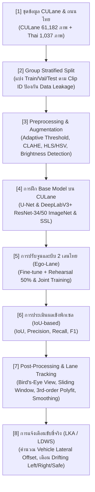

# Lane Detection and Tracking for Thai Roads 🚗💨
### ระบบตรวจจับและติดตามเส้นช่องทางจราจรสำหรับสภาพถนนในประเทศไทย

โครงงานวิศวกรรมการตรวจจับและติดตามเส้นช่องทางจราจรสำหรับสภาพถนนไทย โดยผสานเทคนิค **Traditional Computer Vision (Image Processing)** เข้ากับ **Deep Learning Semantic Segmentation (U-Net / DeepLabV3+)** เพื่อสร้างระบบช่วยเหลือผู้ขับขี่อัจฉริยะ (ADAS) ในการแจ้งเตือนการออกนอกเลน (Lane Departure Warning System: LDWS / Lane Keep Assist: LKA)

---

## 📌 แผนผังกระบวนการทำงานภาพรวม (End-to-End System Pipeline)

การประมวลผลและการพัฒนาทั้งระบบแบ่งออกเป็น 8 ขั้นตอนหลัก ทำงานสอดประสานกันตั้งแต่ระดับข้อมูลจนถึงการแจ้งเตือนบนเฟรมวิดีโอ:



---

## 👥 การแบ่งหน้าที่รับผิดชอบในโครงงาน (Team Roles & Responsibilities)

| ส่วนงาน | ผู้รับผิดชอบหลัก | ขั้นตอนใน Pipeline | ขอบเขตความรับผิดชอบเชิงเทคนิค |
|---|:---:|:---:|---|
| **Image Processing (IP)** | **ปั๊ม** | ขั้นตอนที่ 3, 7, 8 | • ปรับแต่ง Color & Gradient Threshold (HLS/HSV/Sobel) พร้อมระบบตรวจจับกลางวัน/กลางคืน (Day/Night Detection)<br>• การทำ Perspective Transform (Bird's-Eye View)<br>• Sliding Window Lane Tracking และ 3rd-order Polynomial Curve Fitting ($x = Ay^3 + By^2 + Cy + D$)<br>• ระบบ LaneProcessor รักษาความเสถียรของเส้นเลนข้ามเฟรม (Temporal Smoothing 15 เฟรม)<br>• ระบบคำนวณ Lateral Offset และแจ้งเตือน Lane Keep Assist (LKA) |
| **Deep Learning (DL)** | **แม็ก** | ขั้นตอนที่ 2, 4, 5, 6 | • ตี Label (Ground Truth) เองครบทั้ง 1,037 ภาพ + ตรวจความสอดคล้องของ Label ด้วย Inter-Annotator Agreement (เพื่อน 3 คนตี 30% แล้วเทียบพิกัดจุด)<br>• Group Stratified Split ป้องกัน Data Leakage บนชุดข้อมูลไทย 1,037 ภาพ<br>• เทรน Base Model บน CULane 61,182 ภาพ (U-Net & DeepLabV3+)<br>• วิจัยแก้ปัญหา Catastrophic Forgetting ด้วย Experience Rehearsal 50%<br>• ออกแบบ Multi-Domain Joint Training ปลดล็อกโมเดลแชมป์ DeepLabV3+ ResNet-50<br>• พัฒนาสคริปต์ `train_thai_2lanes.py` บีบให้โมเดลทำนายเฉพาะ 2 เลนหน้ารถ (Ego-lane)<br>• สร้าง Handoff Interface (`predict_mask.py`, `eval_masks.py`) เชื่อมต่อระหว่าง DL และ IP |

---

## 🧠 สรุปผลการวิจัยและทดลองฝั่ง Deep Learning (DL Research & Benchmark)

ประเมินบนชุดทดสอบมาตรฐานถนนไทยทางการ (**Thai Test Set 191 ภาพ** ที่โมเดลไม่เคยเห็นตอนเทรน แบ่งแบบ Group Stratified ตามคลิป):

### 1. การเปรียบเทียบภาพรวม 4 ยุทธศาสตร์การทดลอง (The 4 Core DL Strategies)

| อันดับ | ยุทธศาสตร์การทดลอง | ข้อมูลตั้งต้น $\to$ ข้อมูลที่ใช้เทรน | All IoU (%) | Precision (%) | Recall (%) | F1-Score (%) | สรุปผลการประเมินเชิงวิศวกรรม |
| :---: | :--- | :--- | :---: | :---: | :---: | :---: | :--- |
| 4 | **1. Zero-Shot** | CULane (จีน 61k) $\to$ ไม่เทรนเพิ่ม | 35.40% | 45.10% | 62.30% | 52.30% | **Convention Mismatch:** โมเดลติดนิสัยวาด 4 เลนแบบจีน โดนหัก False Positive รุนแรงบนเลนข้างเคียง |
| 3 | **2. Train Thai จากศูนย์** | ImageNet $\to$ ไทยล้วน (749 ภาพ) | 48.97% | 63.80% | 67.20% | 65.50% | **Data Bottleneck:** ข้อมูล 749 ภาพน้อยเกินไป โมเดล Overfit ตั้งแต่ Epoch 10 ความแม่นยำติดเพดาน |
| 2 | **3. Sequential Fine-Tune** | CULane $\to$ ไทยล้วน (749 ภาพ) | 50.63% | 66.34% | 68.14% | 67.23% | **Catastrophic Forgetting:** บีบเหลือ 2 เลนได้ แต่ลืมความแม่นยำกลางคืน (Night IoU ตกจาก *0.336 → 0.173*) ต้องใช้ Rehearsal 50% ดึงกลับมา |
| 🏆 **1** | **4. Joint Training (ตัวจริง)** | CULane + Thai ผสมพร้อมกันในลูปเดียว | **55.12%** | **71.04%** | **68.74%** | **69.87%** | **ชนะเลิศทุกด้าน:** โมดูล ASPP ดึงฟีเจอร์หลายระดับ ไม่ลืมกลางคืน และได้เลนไทย 2 เส้นคมชัด ไม่มีเส้นหลอกกวน IP |

---

### 2. ตารางคะแนนการ Fine-Tune เปรียบเทียบครบทั้ง 6 โมเดล (Sequential 6-Model Benchmark)

ไฟล์ผลลัพธ์ทางการ: [`results/thai/finetune_sequential_6_models_comparison.csv`](cardashcam_train_model/results/thai/finetune_sequential_6_models_comparison.csv)

| อันดับ | สถาปัตยกรรมโมเดล (Architecture + Backbone, Pretrained) | All IoU (%) | Precision (%) | Recall (%) | F1-Score (%) | Normal IoU (%) | Curve IoU (%) | Night IoU (%) |
| :---: | :--- | :---: | :---: | :---: | :---: | :---: | :---: | :---: |
| 1 | **DeepLabV3+ (ResNet-50, ImageNet)** | **50.63%** | 66.34% | 68.14% | **67.23%** | 56.29% | **36.71%** | **24.91%** |
| 2 | **DeepLabV3+ (ResNet-34, ImageNet)** | 50.54% | 65.44% | 68.95% | 67.15% | 57.31% | 35.57% | 20.43% |
| 3 | **U-Net (ResNet-34, ImageNet)** | 50.50% | 64.29% | 70.19% | 67.11% | **57.66%** | 28.87% | 24.23% |
| 4 | **U-Net (ResNet-50, ImageNet)** | 48.45% | 63.61% | 67.02% | 65.27% | 56.83% | 17.89% | 18.57% |
| 5 | **U-Net (ResNet-50, SSL MoCo v2)** | 47.83% | **66.82%** | **75.41%** | 64.71% | 54.98% | 25.21% | 21.38% |
| 6 | **DeepLabV3+ (ResNet-50, SSL MoCo v2)** | 46.67% | 65.33% | 62.03% | 63.64% | 54.81% | 22.68% | 16.30% |

---

### 3. กลไกการบีบถนนให้เหลือ 2 เลน (Ego-Lane Enforcement Mechanism)
* **ที่มาของปัญหา:** CULane มีเฉลยเฉลี่ย 3.00 เส้น/ภาพ (วาดทุกเลน) แต่ชุดข้อมูลไทยเฉลยเฉพาะ **Ego-lane เฉลี่ย 2.00 เส้น/ภาพ (82% ของภาพ)**
* **กลไกการบีบด้วย Loss:** ในการเทรนด้วย `train_thai_2lanes.py` เมื่อโมเดลพยายามวาดเลนข้างเคียงออกมา แต่ใน Mask เฉลยของไทยมีค่าเป็น 0 โมเดลจะโดนทำโทษทันทีในฐานะ **False Positive (FP)** ผ่านฟังก์ชัน `BCE + Dice Loss` บีบให้น้ำหนักในโครงข่ายเลิกตอบสนองต่อเส้นนอกเลนตัวรถโดยอัตโนมัติ

> 📖 **อ่านรายงานวิจัยฉบับสมบูรณ์เจาะลึก 4 การทดลอง:** ดูได้ที่ [`cardashcam_train_model/EXPERIMENTS.md`](cardashcam_train_model/EXPERIMENTS.md)

---

## 🏷️ คุณภาพชุดข้อมูลถนนไทย (Thai Dataset Labeling & Quality Check)

ชุดข้อมูลถนนไทย **1,037 ภาพ** ถูกตี Label (Ground Truth) ด้วยมือทั้งหมด และมีการตรวจสอบความสอดคล้องของการตีเส้นระหว่างคนตี Label หลายคน (Inter-Annotator Agreement) เพื่อยืนยันว่าชุดข้อมูลที่สร้างขึ้นเองมีความน่าเชื่อถือและกติกา Ego-lane 2 เส้นสอดคล้องกัน

* **Person 1 (ผู้ตี Label หลัก):** ตี Label เอง**ครบทุกภาพ 1,037 ภาพ** (Train/Val/Test) ตามกติกา Ego-lane 2 เส้นหน้ารถ
* **Person 2, 3, 4 (เพื่อนช่วยตรวจ):** แต่ละคนตี Label **ภาพชุดย่อย ~30%** (สุ่มแยกคนละชุด) แล้วนำ**พิกัดจุด**ที่ได้มาเทียบกับของ Person 1 เพื่อวัดความถูกต้องของชุดข้อมูล

### ตัวชี้วัดการเทียบ Label (2 แบบ)

| ตัวชี้วัด | สิ่งที่เทียบ | วิธีวัด | ผลลัพธ์ |
| :--- | :--- | :--- | :---: |
| **ความตรงของพิกัดจุด (Point Agreement)** | Person 2, 3, 4 เทียบกับ Person 1 | สุ่มจุดบนเส้นทุก **5 พิกเซล** ตามแกน y รวม **97,201 จุด** แล้วนับสัดส่วนจุดที่ห่างจาก Person 1 **ไม่เกิน 30 พิกเซล** (เกณฑ์เดียวกับ CULane) → เฉลี่ย 3 คน | **90.65%** |
| **Mask IoU (คนเทียบคน)** | Person 3 เทียบกับ Person 4 | แปลงเส้นเป็น Mask หนา **30 พิกเซล** แล้ววัด **Mask IoU** ระหว่างสองคน | **55.16%** |

> **สรุป:** ตัวเลข **90.65%** = ความตรงของพิกัดจุด ระหว่าง Label ของเพื่อนทั้ง 3 (P2/P3/P4) กับ Label หลักของผม (P1) — สุ่มจุดทุก 5 px รวม 97,201 จุด นับจุดที่ห่างกัน ≤ 30 px (เกณฑ์ CULane) แล้วเฉลี่ยคน · ตัวเลข **55.16%** = Mask IoU ระหว่าง Person 3 กับ Person 4 (เทียบคนต่อคน) โดยแปลงเส้นเป็น mask หนา 30 px · ใจความคือชุดไทยถูกตีด้วยมือโดย Person 1 ครบ 1,037 ภาพ และเส้นที่คนตี Label ต่างคนตีตรงกันสูงพอจะใช้เป็น Ground Truth ฝึกโมเดลได้

---

## 🛠️ กระบวนการทำงานฝั่ง Image Processing (Vision Pipeline & LKA)

ระบบประมวลผลภาพแบบ Traditional Computer Vision ทำหน้าที่สกัดเส้นเลน ปรับความโค้ง และคำนวณการขับขี่แบบเรียลไทม์:

1. **Color & Gradient Thresholding (`edge_detection.py`):**
   * ตรวจจับความสว่างภาพเฉลี่ย (`detect_brightness` ใน HSV Space) เพื่อสลับโหมดกลางวัน/กลางคืนอัตโนมัติ
   * ผสาน Yellow Mask (HSV), White Lane Mask (HLS L-channel) และ Sobel X Gradient พร้อมเทคนิค CLAHE และ Adaptive Thresholding
   * ใช้ Morphological Closing เชื่อมรอยต่อของเส้นประ
2. **Perspective Transform & Bird's-Eye View (`perspective.py`):**
   * กำหนดพื้นที่ Region of Interest (ROI) ในลักษณะคางหมูหน้ารถ
   * บิดภาพด้วย Matrix $M$ เป็นมุมมอง Top-down ราบเรียบสำหรับวัดระยะทาง
3. **Sliding Window Lane Tracking (`lane_tracker.py`):**
   * ใช้ Histogram หาตำแหน่งเริ่มต้นของเส้นซ้ายและขวา
   * ลากกรอบเลื่อน (Sliding Windows 9 ระดับ) สแกนติดตามพิกเซลเส้นเลน
   * มีระบบ Fast Search (`search_from_prior`) ค้นหาจากตำแหน่งเดิมของเฟรมก่อนหน้าเพื่อลดการประมวลผล
4. **Polynomial Curve Fitting & Temporal Smoothing (`lane_processor.py`):**
   * ฟิตเส้นโค้งด้วยสมการพหุนามอันดับ 3: $x = Ay^3 + By^2 + Cy + D$
   * บันทึกประวัติและเกลี่ยน้ำหนักเฉลี่ย 15 เฟรมย้อนหลัง (`LaneProcessor`) พร้อม Sanity Check ตรวจสอบความกว้างเลนและความโค้ง ป้องกันเส้นเลนแกว่งหรือสวิงหลุด
5. **Lane Keep Assist (LKA) & Departure Warning:**
   * คำนวณจุดกึ่งกลางเลน $x_{\text{lane}} = \frac{x_{\text{left}} + x_{\text{right}}}{2}$ ที่ขอบล่างสุดของภาพ
   * คำนวณระยะเบี่ยงเบนจากกึ่งกลางกล้อง: $\text{Offset} = x_{\text{lane}} - x_{\text{camera}}$
   * แจ้งเตือนสถานะทันที:
     * `Offset > DRIFT_THRESHOLD` $\rightarrow$ ⚠️ **Warning: Drifting LEFT!** (สีแดง)
     * `Offset < -DRIFT_THRESHOLD` $\rightarrow$ ⚠️ **Warning: Drifting RIGHT!** (สีแดง)
     * สภาพปกติ $\rightarrow$ ✅ **Status: Safe** (สีเขียว)

---

## 🤝 การเชื่อมต่อระหว่าง Deep Learning และ Image Processing (Handoff Interface)

เพื่อให้ทั้งสองระบบทำงานร่วมกันได้อย่างสมบูรณ์:
1. **ข้อกำหนด Mask:** โมเดล DL ทำนายผลลัพธ์เป็นภาพขาวดำ PNG (ค่า 0 = พื้นหลัง, 255 = เส้นเลน) ขนาดมาตรฐาน **$448 \times 800$ พิกเซล**
2. **สคริปต์ทำนายผลอัตโนมัติ (`predict_mask.py`):**
   * สคริปต์ Standalone โหลดโมเดลตัวจริง DeepLabV3+ ResNet-50 ทำนายภาพเดี่ยวหรือทั้งโฟลเดอร์ ส่งออกเป็น Mask พร้อมให้ฝั่ง IP หยิบไปเข้า Sliding Window ได้ทันที
3. **มาตรฐานการวัดผลเดียวกัน (`eval_masks.py`):**
   * เครื่องมือวัดผลร่วม ไม่ต้องพึ่งพาโมเดลหรือ GPU วัดผลเชิงพิกเซลด้วย **IoU (IoU, Precision, Recall, F1)** เพื่อเปรียบเทียบผลระหว่าง DL และ IP บนไม้บรรทัดเดียวกันอย่างเที่ยงตรง

---

## 📂 โครงสร้างไดเรกทอรีโปรเจกต์ (Project Structure)

```text
Project-lane-detection-and-Tracking/
├── image_processing/             # 🛠️ ระบบ Traditional Computer Vision [ปั๊ม : IP]
│   ├── main.py                   # รันการทดสอบภาพเดี่ยวและวิดีโอแสดงผล LKA
│   ├── edge_detection.py         # การกรองสี HLS/HSV, Sobel, CLAHE และ Day/Night Mode
│   ├── perspective.py            # การแปลง Perspective Transform (Bird's-Eye View)
│   ├── lane_tracker.py           # Sliding Window, 3rd-order Polyfit, LKA Departure Warning
│   ├── lane_processor.py         # LaneProcessor รักษาความเสถียรข้าม 15 เฟรม และ Sanity Check
│   └── utils.py                  # ฟังก์ชันช่วยโหลดภาพ/วิดีโอ
│
├── cardashcam_train_model/       # 🧠 ระบบ Deep Learning & การฝึกสอนโมเดล [แม็ก : DL]
│   ├── train_thai_2lanes.py      # 🚗 สคริปต์ฝึกสอนโมเดลบีบ 2 เลนหน้ารถ (Thai Ego-lane)
│   ├── predict_mask.py           # ⚡ สคริปต์สกัด Binary Mask (0/255) ส่งต่อให้ Image Processing
│   ├── EXPERIMENTS.md            # 📑 รายงานผลการทดลองฉบับสมบูรณ์ทั้ง 4 กระบวนการ
│   ├── PIPELINE.md               # รายละเอียดความเชื่อมโยงไฟล์ตาม 8 ขั้นตอน
│   ├── HANDOFF_IP.md             # ข้อกำหนดและอินเทอร์เฟซส่งมอบ Mask ร่วมกัน
│   ├── Deeplearning/             # พื้นที่พัฒนาและไฟล์โน้ตบุ๊ก
│   │   ├── Deeplabv3plus/        # โน้ตบุ๊กเทรน CULane, Thai Scratch, และ Joint Training (DLV3+)
│   │   ├── Unet/                 # โน้ตบุ๊กเทรน CULane, Thai, และ finetune_thai.py (Unet)
│   │   ├── loss_and_metrics/     # slope_loss.py, slope_metrics.py, eval_masks.py
│   │   ├── finetune_all_models.py# สคริปต์รัน Sequential Benchmark ครบทั้ง 6 โมเดล
│   │   └── predict_mask.ipynb    # โน้ตบุ๊กทดสอบโมเดลตัวจริงกับสภาพถนน 4 รูปแบบ
│   ├── data_preprocessing/       # สคริปต์จัดการ Dataset และตรวจสอบสถิติการ Label
│   ├── result_DL/                # ประวัติการเทรน ตารางผลลัพธ์ และกราฟิกสำหรับนำเสนอ
│   ├── results/                  # รายงานวิจัยเฉพาะด้าน (REPORT_THAI, REPORT_NIGHT, REPORT_SLOPELOSS)
│   └── thai_road_lane/           # รายชื่อชุดข้อมูลไทย (train_list, val_list, test_list)
│
├── tools/                        # 🔧 เครื่องมือเสริม
│   └── extract_frames.py         # เครื่องมือสกัดภาพจากวิดีโอกล้องหน้ารถ
│
├── requirements.txt              # รายการ Library ที่ใช้ในโปรเจกต์
└── README.md                     # เอกสารแนะนำและสรุปภาพรวมโครงงาน
```

---

## 🚀 เริ่มต้นใช้งานโปรเจกต์ (Getting Started)

### 1. การติดตั้งสภาพแวดล้อม
```bash
git clone https://github.com/660710095/Project-lane-detection-and-Tracking-.git
cd Project-lane-detection-and-Tracking-
pip install -r requirements.txt
```

### 2. การใช้งานโมเดล Deep Learning
```bash
cd cardashcam_train_model

# 2.1 สกัด Binary Mask สำหรับภาพเดี่ยวเพื่อส่งต่อให้ IP
python predict_mask.py --input path/to/image.jpg --output mask.png

# 2.2 สกัด Binary Mask ทั้งหมดสำหรับชุดทดสอบถนนไทย (191 ภาพ)
python predict_mask.py --batch --csv dataset/Thai_road_lane/test_list.csv --out-dir results/ip/pred_masks_dl

# 2.3 ฝึกสอนโมเดลบีบ 2 เลนหน้ารถ (Thai Ego-Lane Fine-Tuning)
python train_thai_2lanes.py --epochs 30 --batch-size 16
```

### 3. การประมวลผลฝั่ง Image Processing & LKA
```bash
# รันระบบตรวจจับเส้นเลนและแจ้งเตือนการออกนอกเลน
python image_processing/main.py
```

---

## 🎓 โครงงานพัฒนา
* **หัวข้อโครงงาน**: การตรวจจับและติดตามเส้นช่องทางจราจรสำหรับถนนในประเทศไทย (Senior Project)
* **ผู้จัดทำ**: ทีมพัฒนาโครงงานตรวจจับและติดตามเส้นช่องทางจราจร
* **เอกสารอ้างอิงเพิ่มเติม**:
  * รายงานการทดลองเปรียบเทียบฉบับสมบูรณ์: [`cardashcam_train_model/EXPERIMENTS.md`](cardashcam_train_model/EXPERIMENTS.md)
  * ข้อกำหนดและรายละเอียด Pipeline 8 ขั้นตอน: [`cardashcam_train_model/PIPELINE.md`](cardashcam_train_model/PIPELINE.md)
  * คู่มือการส่งมอบ Mask ระหว่างโมดูล: [`cardashcam_train_model/HANDOFF_IP.md`](cardashcam_train_model/HANDOFF_IP.md)
