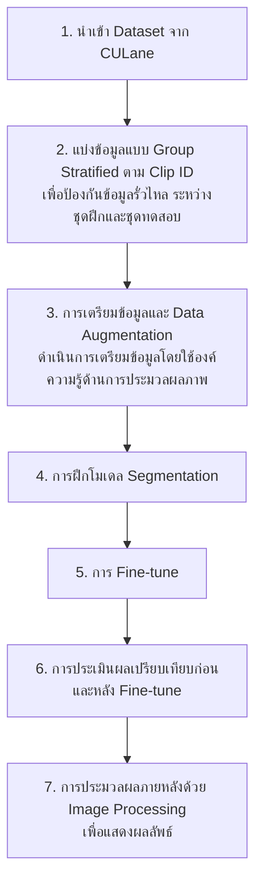

# 5.1 โครงสร้างของระบบ (System Architecture & Pipeline)

> โครงสร้างโดยรวมของระบบตรวจจับเลนถนน แสดงดังรูปที่ 5.1 อ้างอิงตามรายงานโครงการ (หน้า 28)

---

## สรุปการเชื่อมโยงขั้นตอนกับไฟล์ในระบบ (Pipeline File Mapping)

| ขั้นตอนตามรูปที่ 5.1 | ผู้รับผิดชอบ | ไฟล์โค้ด / สคริปต์หลัก | ไฟล์ผลลัพธ์ / ข้อมูลที่เกี่ยวข้อง |
|---|:---:|---|---|
| **1. นำเข้า Dataset จาก CULane** | - | - | `/home/jovyan/shared/donut/CarDashCam/CULane` (~87,000 ภาพ) |
| **2. แบ่งข้อมูลแบบ Group Stratified ตาม Clip ID** | แม็ก (DL) | [data_preprocessing/make_subsets.py](file:///home/jovyan/cardashcam_train_model/data_preprocessing/make_subsets.py) | [dataset/Thai_road_lane/train_list.csv](file:///home/jovyan/cardashcam_train_model/dataset/Thai_road_lane/train_list.csv) [dataset/Thai_road_lane/val_list.csv](file:///home/jovyan/cardashcam_train_model/dataset/Thai_road_lane/val_list.csv) [dataset/Thai_road_lane/test_list.csv](file:///home/jovyan/cardashcam_train_model/dataset/Thai_road_lane/test_list.csv) |
| **3. การเตรียมข้อมูลและ Data Augmentation** | ปั๊ม (IP) + แม็ก (DL) | [data_preprocessing/dataset.py](file:///home/jovyan/cardashcam_train_model/data_preprocessing/dataset.py) [data_preprocessing/check_annotation_style.py](file:///home/jovyan/cardashcam_train_model/data_preprocessing/check_annotation_style.py) [data_preprocessing/check_convention_effect.py](file:///home/jovyan/cardashcam_train_model/data_preprocessing/check_convention_effect.py) | [data_preprocessing/augmentation_demo.png](file:///home/jovyan/cardashcam_train_model/data_preprocessing/augmentation_demo.png) [dataset/Thai_road_lane/](file:///home/jovyan/cardashcam_train_model/dataset/Thai_road_lane/) |
| **4. การฝึกโมเดล Segmentation** | แม็ก (DL) | [Deeplearning/Unet/1_train_CULane.ipynb](file:///home/jovyan/cardashcam_train_model/Deeplearning/Unet/1_train_CULane.ipynb) [Deeplearning/Deeplabv3plus/1_train_CULane_DLV3.ipynb](file:///home/jovyan/cardashcam_train_model/Deeplearning/Deeplabv3plus/1_train_CULane_DLV3.ipynb) | [result/result_Unet/unet_CULane/](file:///home/jovyan/cardashcam_train_model/result/result_Unet/unet_CULane/) [result/result_DLV3PLUS/DLV3PLUS_CULane/](file:///home/jovyan/cardashcam_train_model/result/result_DLV3PLUS/DLV3PLUS_CULane/) |
| **5. การ Fine-tune** | แม็ก (DL) | [Deeplearning/Unet/2_train_Thai.ipynb](file:///home/jovyan/cardashcam_train_model/Deeplearning/Unet/2_train_Thai.ipynb) [Deeplearning/Unet/3_train_CULane_Thai.ipynb](file:///home/jovyan/cardashcam_train_model/Deeplearning/Unet/3_train_CULane_Thai.ipynb) [Deeplearning/Unet/finetune_thai.py](file:///home/jovyan/cardashcam_train_model/Deeplearning/Unet/finetune_thai.py) [Deeplearning/Deeplabv3plus/2_train_Thai_DLV3.ipynb](file:///home/jovyan/cardashcam_train_model/Deeplearning/Deeplabv3plus/2_train_Thai_DLV3.ipynb) [Deeplearning/Deeplabv3plus/3_train_CULane_Thai_DLV3.ipynb](file:///home/jovyan/cardashcam_train_model/Deeplearning/Deeplabv3plus/3_train_CULane_Thai_DLV3.ipynb) | [result/result_Unet/unet_Thai/model/resnet50_ssl/thai_ft_rh_s1_best_f1.pth](file:///home/jovyan/cardashcam_train_model/result/result_Unet/unet_Thai/model/resnet50_ssl/thai_ft_rh_s1_best_f1.pth) (โมเดลดีสุด) [result/result_Unet/unet_Thai/](file:///home/jovyan/cardashcam_train_model/result/result_Unet/unet_Thai/) [result/result_DLV3PLUS/DLV3PLUS_Thai/](file:///home/jovyan/cardashcam_train_model/result/result_DLV3PLUS/DLV3PLUS_Thai/) |
| **6. การประเมินผลเปรียบเทียบก่อนและหลัง Fine-tune** | แม็ก (DL) | [Deeplearning/loss_and_metrics/eval_masks.py](file:///home/jovyan/cardashcam_train_model/Deeplearning/loss_and_metrics/eval_masks.py) [Deeplearning/loss_and_metrics/slope_metrics.py](file:///home/jovyan/cardashcam_train_model/Deeplearning/loss_and_metrics/slope_metrics.py) [Deeplearning/loss_and_metrics/plot_thai_examples.py](file:///home/jovyan/cardashcam_train_model/Deeplearning/loss_and_metrics/plot_thai_examples.py) [Deeplearning/loss_and_metrics/slope_metrics_lab.ipynb](file:///home/jovyan/cardashcam_train_model/Deeplearning/loss_and_metrics/slope_metrics_lab.ipynb) [Deeplearning/loss_and_metrics/evaluate_metrics_comparison.ipynb](file:///home/jovyan/cardashcam_train_model/Deeplearning/loss_and_metrics/evaluate_metrics_comparison.ipynb) | [result/all_history_plots/](file:///home/jovyan/cardashcam_train_model/result/all_history_plots/) [result/result_Unet/unet_Thai/test_metrics_comparison.csv](file:///home/jovyan/cardashcam_train_model/result/result_Unet/unet_Thai/test_metrics_comparison.csv) [result/result_Unet/unet_Thai/overall_comparison_all_models.png](file:///home/jovyan/cardashcam_train_model/result/result_Unet/unet_Thai/overall_comparison_all_models.png) |
| **7. การประมวลผลภายหลังด้วย Image Processing เพื่อแสดงผลลัพธ์** | ปั๊ม (IP) | [Deeplearning/predict_mask.ipynb](file:///home/jovyan/cardashcam_train_model/Deeplearning/predict_mask.ipynb) (ตัวส่งมอบ Mask จาก DL) [Deeplearning/loss_and_metrics/eval_masks.py](file:///home/jovyan/cardashcam_train_model/Deeplearning/loss_and_metrics/eval_masks.py) | [HANDOFF_IP.md](file:///home/jovyan/cardashcam_train_model/HANDOFF_IP.md) [results/ip/](file:///home/jovyan/cardashcam_train_model/results/ip/) [results/ip_for_create_line/](file:///home/jovyan/cardashcam_train_model/results/ip_for_create_line/) [results/ip_slope/](file:///home/jovyan/cardashcam_train_model/results/ip_slope/) [Tollway_road_curve03.mp4](file:///home/jovyan/cardashcam_train_model/Tollway_road_curve03.mp4) |

---

## รายละเอียดเชิงลึกในแต่ละขั้นตอน

### 1. นำเข้า Dataset จาก CULane
* **ข้อมูล:** ชุดข้อมูล CULane ขนาดใหญ่จากจีน รวม ~87,000 ภาพ (Train 61,183 ภาพ)
* **พาธ:** `/home/jovyan/shared/donut/CarDashCam/CULane`
* **วัตถุประสงค์:** ใช้เป็นความรู้ตั้งต้น (Pretrained Feature Extractor) เพื่อให้โมเดลเข้าใจโครงสร้างพื้นฐานของถนนและเส้นเลนจราจรในสภาพแสงหลากหลาย

### 2. แบ่งข้อมูลแบบ Group Stratified ตาม Clip ID เพื่อป้องกันข้อมูลรั่วไหล ระหว่างชุดฝึกและชุดทดสอบ
* **วัตถุประสงค์:** แบ่งข้อมูลภาพถนนไทย (Thai Road Dataset) 1,037 ภาพ โดยตัดแบ่งตาม Clip ID ของวิดีโอ เพื่อป้องกันปัญหา Data Leakage (ป้องกันไม่ให้เฟรมจากคลิปเดียวกันหลุดไปอยู่ทั้งในชุด Train และชุด Test)
* **สัดส่วน:** 
  * ชุดฝึก (Train): 726 ภาพ
  * ชุดตรวจสอบ (Val): 208 ภาพ
  * ชุดทดสอบ (Test): 104 ภาพ (ครอบคลุมทั้งสภาวะกลางวัน กลางคืน ทางตรง และทางโค้ง)
* **สคริปต์หลัก:** [`data_preprocessing/make_subsets.py`](file:///home/jovyan/cardashcam_train_model/data_preprocessing/make_subsets.py)

### 3. การเตรียมข้อมูลและ Data Augmentation ดำเนินการเตรียมข้อมูลโดยใช้องค์ความรู้ด้านการประมวลผลภาพ
* **การย่อขนาดภาพ (Resize):** ปรับขนาดภาพเป็น $448 \times 800$ พิกเซล (หารด้วย 32 ลงตัวตามสถาปัตยกรรม Feature Pyramid / Encoder-Decoder)
* **Data Augmentation:**
  * Horizontal Flip (สุ่มกลับภาพซ้าย-ขวา 50%)
  * Brightness & Contrast Adjustment (สุ่มปรับความสว่าง ±30% จำลองสภาวะแสงแดดและเงามืด)
* **คลาสหลัก:** [`LaneDataset`](file:///home/jovyan/cardashcam_train_model/data_preprocessing/dataset.py) ใน `data_preprocessing/dataset.py`

### 4. การฝึกโมเดล Segmentation
* **สถาปัตยกรรม:** 
  1. **U-Net:** ResNet-34 (ImageNet), ResNet-50 (ImageNet), ResNet-50 (MoCo v2 SSL)
  2. **DeepLabV3+:** ResNet-34 (ImageNet), ResNet-50 (ImageNet), ResNet-50 (MoCo v2 SSL)
* **กระบวนการเทรน:** ใช้ Loss แบบผสม (BCE + Dice Loss) และ Adam Optimizer เทรนบน CULane เพื่อสร้าง Base Checkpoints สำหรับแต่ละสถาปัตยกรรม
* **ผลลัพธ์:** เก็บไว้ใน [`result/result_Unet/unet_CULane/`](file:///home/jovyan/cardashcam_train_model/result/result_Unet/unet_CULane/) และ [`result/result_DLV3PLUS/DLV3PLUS_CULane/`](file:///home/jovyan/cardashcam_train_model/result/result_DLV3PLUS/DLV3PLUS_CULane/)

### 5. การ Fine-tune
* **เทคนิค Rehearsal 50%:** ในแต่ละ Mini-batch ทำการผสมข้อมูลภาพถนนไทย (Thai Road) 50% ร่วมกับข้อมูล CULane 50% เพื่อป้องกันปัญหาโมเดลลืมสภาพการขับขี่กลางคืน (Catastrophic Forgetting)
* **กลยุทธ์การเทรน:** ปรับ Learning Rate ให้เหมาะสม ($1 \times 10^{-5}$) พร้อมทดสอบร่วมกับ Slope-aware Loss
* **โมเดลที่ให้ผลลัพธ์ดีที่สุด (SOTA):**
  * `thai_ft_rh_s1_best_f1.pth` (U-Net + ResNet-50 SSL)
  * เก็บไว้ที่ [`result/result_Unet/unet_Thai/model/resnet50_ssl/thai_ft_rh_s1_best_f1.pth`](file:///home/jovyan/cardashcam_train_model/result/result_Unet/unet_Thai/model/resnet50_ssl/thai_ft_rh_s1_best_f1.pth)

### 6. การประเมินผลเปรียบเทียบก่อนและหลัง Fine-tune
* **ตัวชี้วัด:**
  * ความทับซ้อนและประสิทธิภาพเชิงพิกเซล: IoU, Precision, Recall, F1-Score
  * ความถูกต้องทางเรขาคณิตของเส้นเลน: Angle Error (องศาความชันเส้นเลน)
* **ผลการเปรียบเทียบบนชุดทดสอบถนนไทย (Test Set):**
  * **ก่อน Fine-tune (Zero-shot CULane):** IoU 0.354, F1 0.523, มุมคลาดเคลื่อน 1.90°
  * **หลัง Fine-tune (Thai + Rehearsal 50%):** **IoU 0.470**, **F1 0.640**, Recall **0.856**, มุมคลาดเคลื่อน 2.01°
* **กราฟและตารางสรุปผล:** ดูได้ที่ [`result/all_history_plots/`](file:///home/jovyan/cardashcam_train_model/result/all_history_plots/) และ [`result/result_Unet/unet_Thai/test_metrics_comparison.csv`](file:///home/jovyan/cardashcam_train_model/result/result_Unet/unet_Thai/test_metrics_comparison.csv)

### 7. การประมวลผลภายหลังด้วย Image Processing เพื่อแสดงผลลัพธ์
* **การส่งมอบข้อมูล (Handoff Interface):** ฝั่ง Deep Learning ส่งมอบ Binary Mask ขนาดเท่าเฟรมต้นฉบับ (ค่า 0 หรือ 255) ผ่านฟังก์ชัน `predict_mask()` ใน [`Deeplearning/predict_mask.ipynb`](file:///home/jovyan/cardashcam_train_model/Deeplearning/predict_mask.ipynb)
* **การประมวลผลของฝั่ง Image Processing:**
  * คัดแยกเส้นเลนด้วย Sliding Window Search
  * ปรับเส้นโค้งด้วย 2nd-order Polynomial Curve Fitting
  * ติดตามเส้นเลนข้ามเฟรม (Lane Tracking) และคำนวณการเบี่ยงเบนเพื่อแจ้งเตือนการออกนอกเลน (Lane Departure Warning)
* **โค้ดและผลลัพธ์ของฝั่ง IP:** เก็บไว้ใน [`results/ip/`](file:///home/jovyan/cardashcam_train_model/results/ip/), [`results/ip_for_create_line/`](file:///home/jovyan/cardashcam_train_model/results/ip_for_create_line/) และ [`results/ip_slope/`](file:///home/jovyan/cardashcam_train_model/results/ip_slope/)
